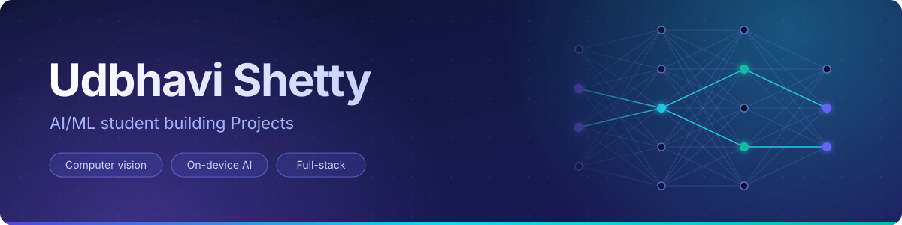

 

## 👋 About

I'm an AI/ML student who likes taking an idea past the notebook stage: into a browser tab, onto a phone, or in front of a real database. My strongest work so far is **SignSpeak AI**, a sign-language recognition app whose model runs entirely on the user's device.

I'm most interested in computer vision and in the engineering around a model: exporting it, shrinking it, shipping it, and testing the logic that surrounds it.

<table>
<tr>
<td width="33%" valign="top">

**🔒 On-device by default** 
SignSpeak moved from a paid cloud API to in-browser inference, so webcam frames never leave the device.

</td>
<td width="33%" valign="top">

**🧪 Logic you can test** 
TribalScholar's eligibility decisions come from a unit-tested rules engine, not a model's guess.

</td>
<td width="33%" valign="top">

**📋 Honest about status** 
My READMEs say what works, what is a prototype and what is not built yet.

</td>
</tr>
</table>

 

## 🚀 Featured projects

<table>
<tr>
<td width="50%" valign="top">

### 🤟 [SignSpeak AI](https://github.com/UdbhaviShetty/Handgesture)
**Real-time sign-language recognition that runs in the browser.**

- Custom **YOLOv5s** detector (7.2M parameters), trained in PyTorch and exported to **ONNX**
- **INT8-quantised to 7.5 MB** and served with ONNX Runtime Web
- Recognises Hello, I love you, No, Please, Thanks, Yes and the ASL alphabet
- Adds a **MediaPipe** landmark classifier alongside the detector
- React + Vite frontend, configured for free static hosting on Vercel

</td>
<td width="50%" valign="top">

### 🎓 [TribalScholar](https://github.com/UdbhaviShetty/TribalScholar)
**A mobile-first scholarship-support app for web, Android and iOS.**

- Built with **Expo / React Native** and **Supabase** (Auth + PostgreSQL)
- Eligibility comes from a **deterministic, unit-tested rules engine**, not an AI model
- Search, saved scholarships, application tracking and deadline alerts
- **50 automated tests** (21 core engine, 29 app data layer)
- Prototype status: bundled scholarship records are fictional demo data

</td>
</tr>
<tr>
<td width="50%" valign="top">

### ⚙️ [fastapiapp](https://github.com/UdbhaviShetty/fastapiapp)
**A full-stack app with a FastAPI backend and a TypeScript frontend.**

<!-- TODO: replace the line below with one sentence on what this app does. -->
- My most actively developed repository (42 commits)
- Separate `backend/` and `frontend/` folders with environment-based configuration

</td>
<td width="50%" valign="top">

### 🗂️ [employee_attendance](https://github.com/UdbhaviShetty/employee_attendance)
**An attendance and salary processor in core Python.**

- Computes attendance %, overtime pay and a 10% penalty for attendance below 75%
- Reads a 500-record CSV and exports a salary report with department-wise summaries
- Standard library only, with a unit-test suite

</td>
</tr>
</table>

 

## 🧰 Tech stack

<table>
<tr>
<td width="150"><b>Languages</b></td>
<td>

</td>
</tr>
<tr>
<td><b>ML and vision</b></td>
<td>

</td>
</tr>
<tr>
<td><b>Web and mobile</b></td>
<td>

</td>
</tr>
<tr>
<td><b>Backend and data</b></td>
<td>

</td>
</tr>
<tr>
<td><b>Tooling</b></td>
<td>

</td>
</tr>
</table>

 

<!--
GITHUB STATS: deliberately left out for now.
With a handful of young repositories the cards would show small numbers and
undersell your work. Once you have more activity, uncomment this block.

  

-->

<!--
CONNECT: add only the links you want recruiters to use, then uncomment.

## 📫 Connect

-->
